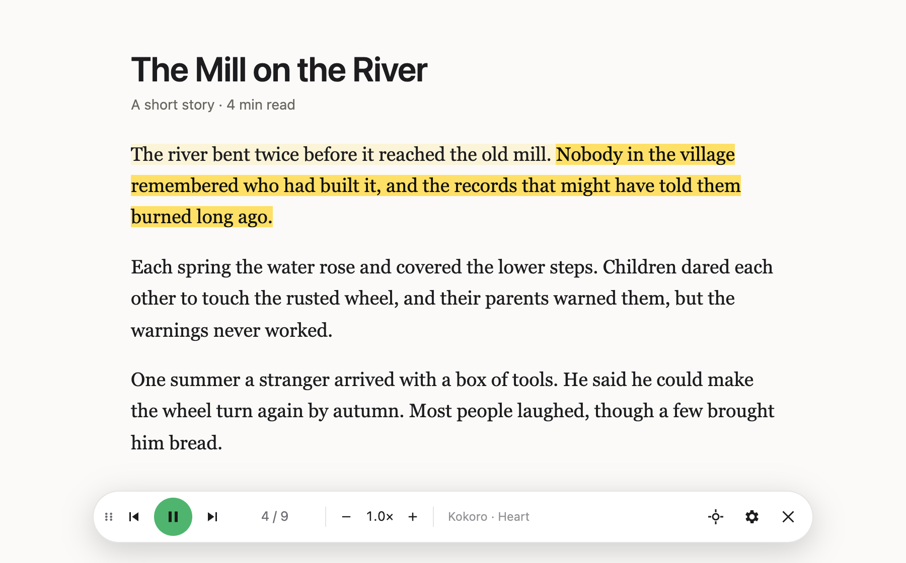

+++
title = 'Narro'
date = 2026-10-23
summary = 'A Chrome extension that reads web pages aloud with natural AI voices, in the cloud or entirely in your browser.'
draft = false
+++

I wanted a read-aloud extension that sounds like a person, not a 2010 GPS. The ones I tried used
voices I didn't enjoy listening to for more than a few minutes, so I built **Narro**. It reads the
page you're on, highlights each sentence as it's spoken, and works with modern AI voices: cloud
ones with your own API key, or ones that run entirely in your browser with no account at all.



## Voices

- **In your browser:** Kokoro (the default), Supertonic and Piper. Each is a one-time download, after which it works offline and nothing you read leaves your computer.
- **Cloud:** OpenAI, ElevenLabs, Google Gemini, or OpenRouter, where one key gives you speech models from many providers.
- **Other:** any OpenAI-compatible speech server on your own machine, or your system's built-in voices.

## What it does

- Highlights each sentence as it's read, and scrolls to follow along.
- Sends several sentences at a time, so the voice keeps a natural rhythm instead of resetting at every full stop.
- Lets you start anywhere: click **Start from…** and pick a sentence, or select text and right-click.
- Remembers where you stopped on each page.
- Skips half-sentences cut off at the edge of a page, and joins a sentence that continues on the next page.
- Can be paused or stopped from any tab. The toolbar icon shows a red ▶︎ while it's playing.
- Reads Kindle Cloud Reader books using on-device text recognition, turning pages as it goes.


## Privacy

With an in-browser voice, nothing leaves your computer. With a cloud voice, the text being read goes
to that provider under your own account. API keys stay in your browser and are never synced. Narro
has no analytics, accounts or servers of its own.

## Try it

Narro isn't on the Chrome Web Store yet. You can build and load it from source:

```sh
git clone https://github.com/swrdfish/Narro.git
cd Narro
npm install
npm run build
```

Then open `chrome://extensions`, turn on **Developer mode**, choose **Load unpacked** and select the
`dist/` folder.

The code is on [GitHub](https://github.com/swrdfish/Narro) under the MIT license, and the
[issue tracker](https://github.com/swrdfish/Narro/issues) is the place for bugs and ideas.
